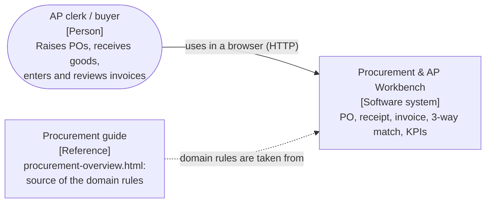
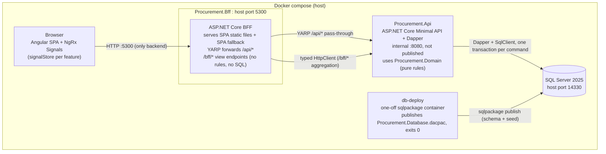
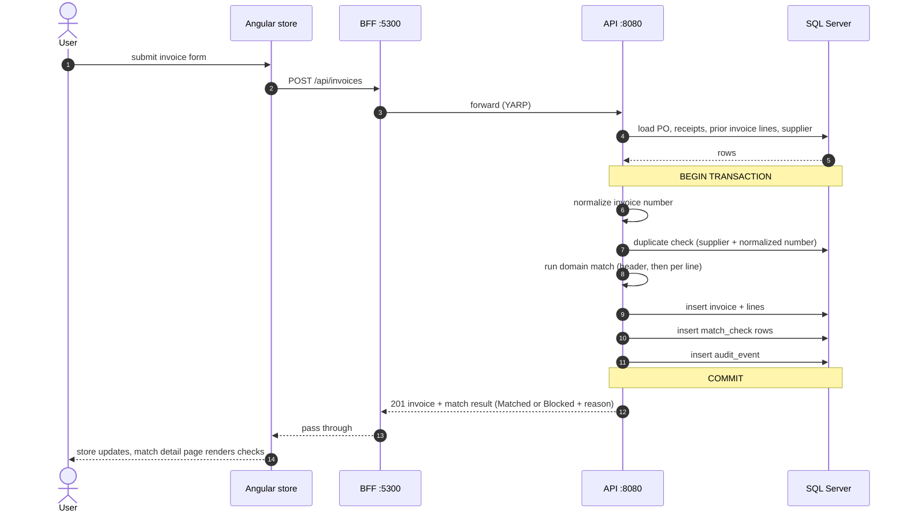

# Architecture: Procurement & AP Workbench

A procurement and accounts-payable workbench: raise a purchase order, receive goods, enter the supplier's invoice and watch the automatic 3-way match pass or block. An Angular single-page app talks only to a .NET BFF; a .NET Minimal API owns the rules and the data; SQL Server's schema is owned by a dacpac. Everything runs with one `docker compose up`.

Spec: [docs/superpowers/specs/2026-11-13-procurement-app-design.md](docs/superpowers/specs/2026-11-13-procurement-app-design.md). Plan: [PLAN.md](PLAN.md).

## C4 Level 1: System context

No authentication in scope: a configured demo actor name is recorded on audit rows. No ERP, payment or OCR integration.

## C4 Level 2: Containers

Compose order: `sqlserver` (healthy) then `db-deploy` (exits 0) then `api` then `bff`.

## Sequence: enter invoice

A duplicate returns 409; bad references (unknown or unapproved PO, blocked supplier, currency mismatch) yield a Blocked invoice with a readable reason, not an error page.

## Rules the diagram encodes

- The browser talks only to the BFF, never to the API or SQL Server.
- The BFF holds no business rules, no SQL and no connection string; it serves the SPA, forwards `/api/*` and shapes `/bff/*` screen payloads.
- The schema lives only in the dacpac (`db/Procurement.Database`); no EF, nothing in app startup changes tables.
- Money-moving status changes (approve PO, block/match invoice) write an `audit_event` in the same transaction as the change.
- Secrets (SA password, connection string) live only in a git-ignored `.env`; `.env.example` documents them.
- The API is internal; only the BFF (5300) and SQL Server (14330, for local tests and tooling) are published to the host.

## Layer to stack-branch map

Topic `procurement`, trunk `main`. One PR per layer; each builds and passes its own tests.

| # | Branch | Layer | Tasks |
|---|---|---|---|
| 0 | `procurement/00-design` | spec + plan + architecture | 0 |
| 1 | `procurement/01-schema` | schema (dacpac, seed, test support) | 1 |
| 2 | `procurement/02-domain` | domain | 2, 3 |
| 3 | `procurement/03-api` | api | 4, 5 |
| 4 | `procurement/04-bff` | bff | 6 |
| 5 | `procurement/05-ui` | ui | 7, 8 |
| 6 | `procurement/06-infra-docs` | infra + docs | 9 |
